import Outcome from '../../../../components/Outcome.astro';

## Punca Kuasa
### Tambah Punca Kuasa 
Peranan: Penyedia Program / Pengurus Program

Langkah:
1. Klik **Program** pada *Sidebar*
2. Pilih program yang berkaitan
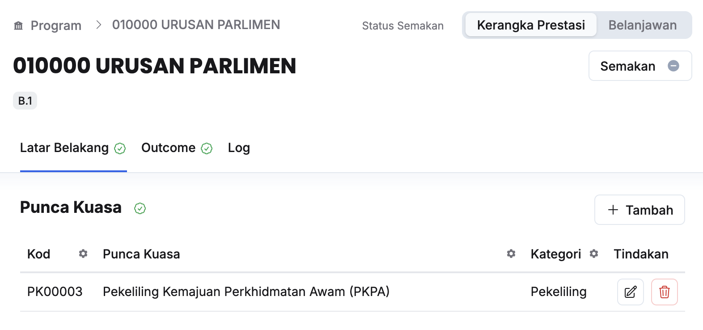
3. Klik butang **+ Tambah** pada sudut kanan tajuk **Punca Kuasa**
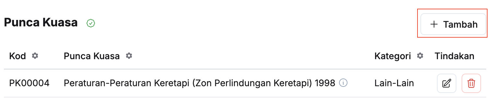
4. Isikan maklumat dalam medan:
    * Punca Kuasa
    * Keterangan
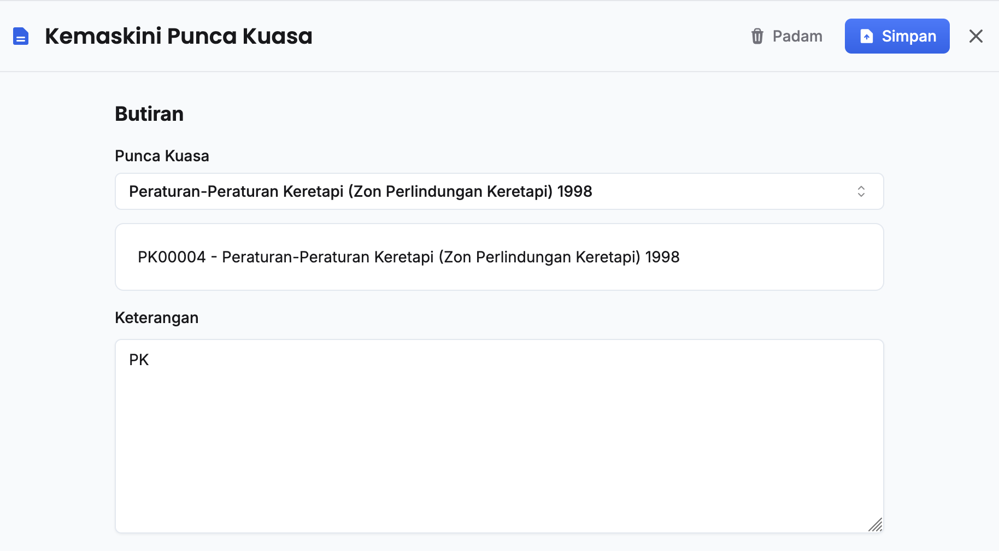
5. Klik butang **Simpan**
6. Pastikan punca kuasa telah tersenarai

<Outcome>
Maklumat punca kuasa berjaya ditambahkan
</Outcome>

### Kemaskini Punca Kuasa
Peranan: Penyedia Program / Pengurus Program

Langkah:
1. Klik **Program** pada *Sidebar*
2. Pilih program yang berkaitan

3. Klik butang **Kemaskini** pada sudut kanan punca kuasa yang berkaitan
 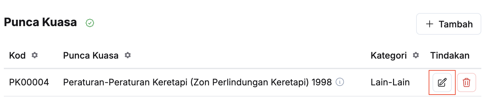
4. Kemaskini:
    * Punca Kuasa
    * Keterangan
    
5. Klik butang **Simpan**
6. Pastikan maklumat punca kuasa yang berkaitan telah dikemaskini

<Outcome> 
Maklumat punca kuasa berjaya dikemaskini
</Outcome>

### Padam Punca Kuasa
Peranan: Penyedia Program / Pengurus Program

Langkah:
1. Klik **Program** pada *Sidebar*
2. Pilih program yang berkaitan
 
3. Klik butang **Padam** pada sudut kanan punca kuasa yang berkaitan
 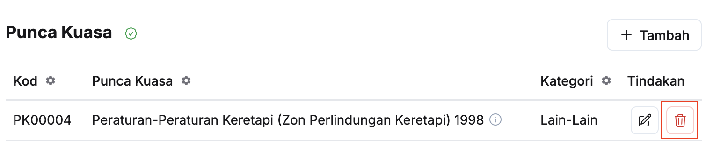
4. Klik butang **Teruskan** pada paparan **Padam punca kuasaa**
5. Pastikan punca kuasa yang berkaitan telah dipadamkan

<Outcome>
Bidang kuasa berjaya dipadamkan
</Outcome>

## Bidang Kuasa
### Tambah Bidang Kuasa 
Peranan: Penyedia Program / Pengurus Program

Langkah:
1. Klik **Program** pada *Sidebar*
2. Pilih program yang berkaitan
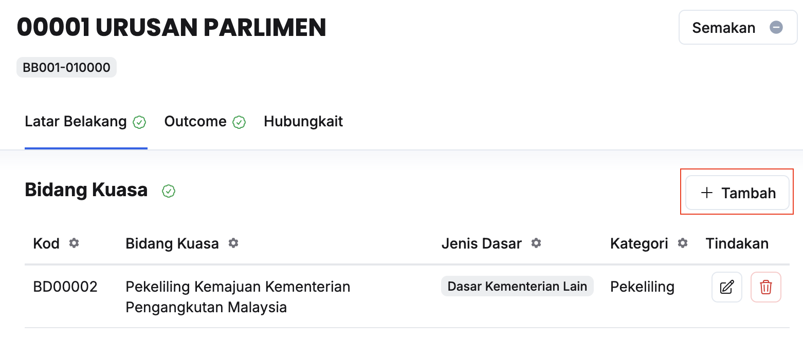
3. Klik butang **+ Tambah** pada sudut kanan tajuk **Bidang Kuasa**
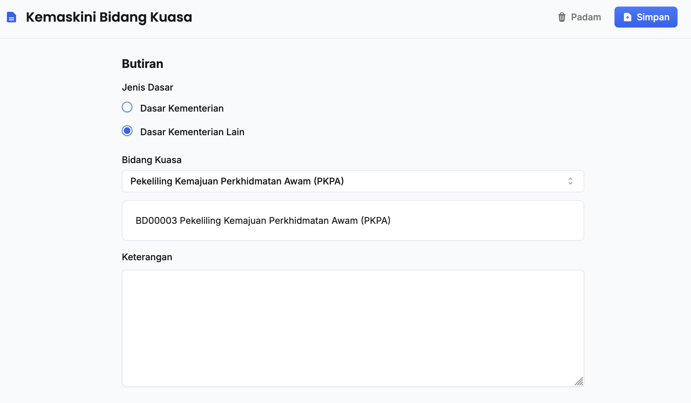
4. Pilih **Jenis Dasar** dan **Bidang Kuasa**
5. Isikan maklumat dalam medan **Keterangan**
6. Klik butang **Simpan**
7. Pastikan bidang kuasa telah tersenarai

<Outcome>
Maklumat bidang kuasa berjaya ditambahkan
</Outcome>

### Kemaskini Bidang Kuasa
Peranan: Penyedia Program / Pengurus Program

Langkah:
1. Klik **Program** pada *Sidebar*
2. Pilih program yang berkaitan
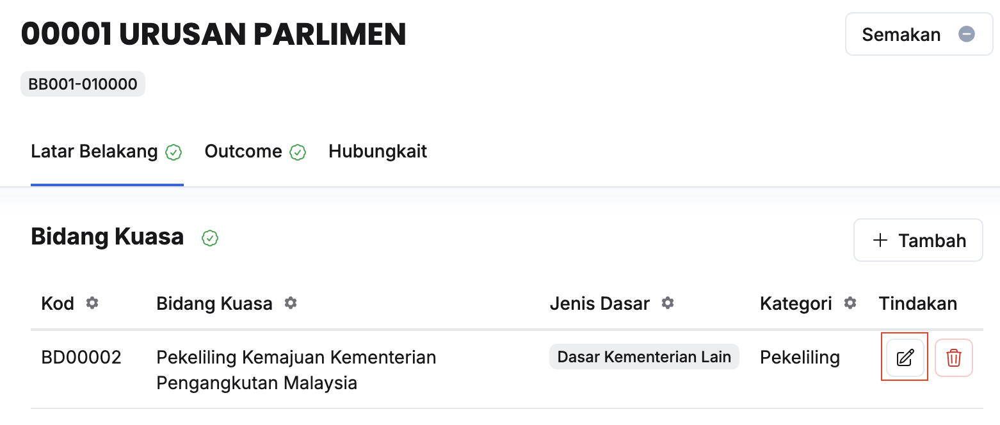
3. Klik butang **Kemaskini** pada sudut kanan bidang kuasa yang berkaitan

4. Kemaskini:
    * Jenis Dasar
    * Bidang Kuasa
    * Keterangan
5. Klik butang **Simpan**
6. Pastikan maklumat bidang kuasa yang berkaitan telah dikemaskini

<Outcome> 
Maklumat bidang kuasa berjaya dikemaskini
</Outcome>

### Padam Bidang Kuasa
Peranan: Penyedia Program / Pengurus Program

Langkah:
1. Klik **Program** pada *Sidebar*
2. Pilih program yang berkaitan
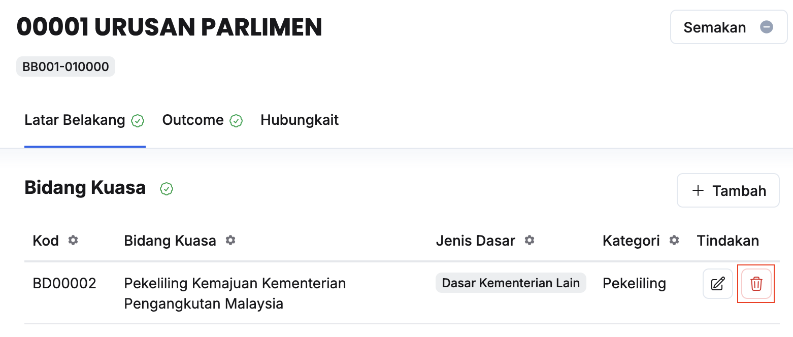
3. Klik butang **Padam** pada sudut kanan bidang kuasa yang berkaitan
4. Klik butang **Teruskan** pada paparan **Padam bidang kuasaa**
5. Pastikan bidang kuasa yang berkaitan telah dipadamkan

<Outcome>
Bidang kuasa berjaya dipadamkan
</Outcome>

## Pelanggan Langsung / Tidak Langsung
### Tambah Pelanggan
Peranan: Penyedia Program / Pengurus Program

Langkah:
1. Klik **Program** pada *Sidebar*
2. Pilih program yang berkaitan
 
3. Klik butang **+ Tambah** pada sudut kanan tajuk **Pelanggan Langsung / Pelanggan Tidak Langsung**
 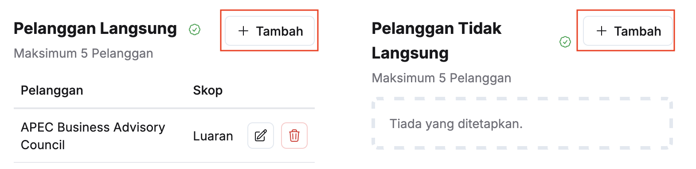
4. Isikan maklumat dalam medan:
    * Kategori Pelanggan
    * Skop Pelanggan
    * Nama Pelanggan
     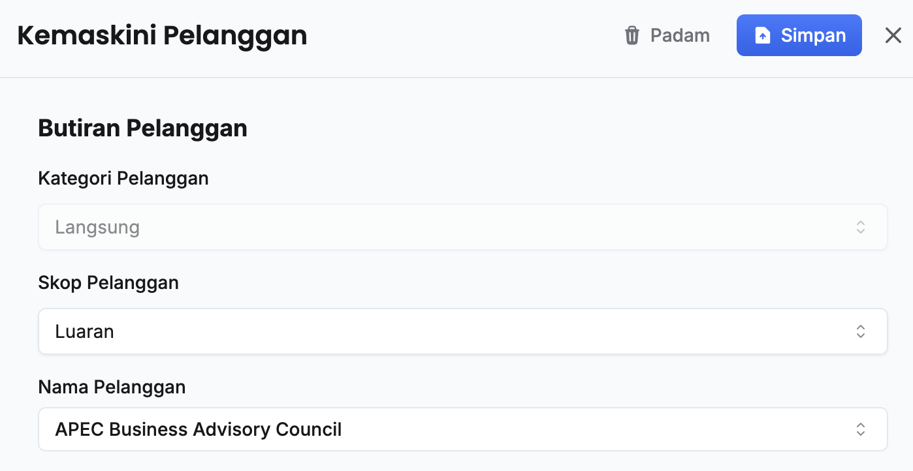
5. Klik butang **Simpan**
6. Pastikan pelanggan telah tersenarai

<Outcome>
Pelanggan berjaya ditambahkan
</Outcome>

### Kemaskini Maklumat Pelanggan 
Peranan: Penyedia Program / Pengurus Program

Langkah:
1. Klik **Program** pada *Sidebar*
2. Pilih program yang berkaitan
 
3. Klik butang **Kemaskini** pada sudut kanan pelanggan yang berkaitan
 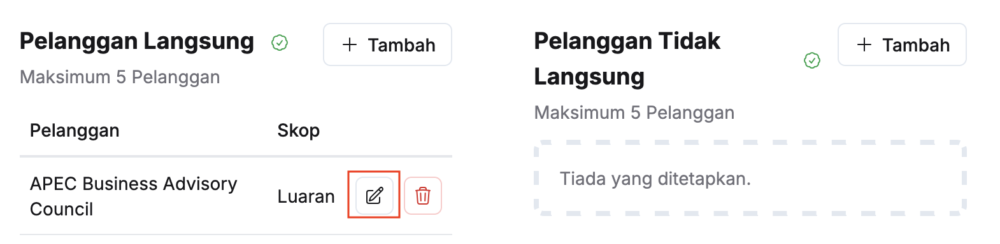
4. Kemaskini:
    * Kategori Pelanggan
    * Skop Pelanggan
    * Nama Pelanggan
     
5. Klik butang **Simpan**
6. Pastikan maklumat pelanggan yang berkaitan telah dikemaskini

<Outcome>
Maklumat pelanggan berjaya dikemaskini
</Outcome>

### Padam Pelanggan 
Peranan: Penyedia Program / Pengurus Program

Langkah:
1. Klik **Program** pada *Sidebar*
2. Pilih program yang berkaitan
 
3. Klik butang **Padam** pada sudut kanan pelanggan yang berkaitan
 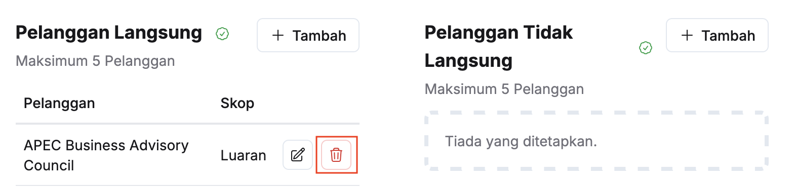
4. Klik butang **Teruskan** pada paparan **Padam Pelanggan**
5. Pastikan pelanggan yang berkaitan telah dipadamkan

<Outcome>
Pelanggan berjaya dipadamkan
</Outcome>

## Masalah Pelanggan 
### Tambah Masalah
Peranan: Penyedia Program / Pengurus Program

Langkah:
1. Klik **Program** pada *Sidebar*
2. Pilih program yang berkaitan
 
3. Klik butang **+ Tambah** pada sudut kanan tajuk **Masalah**
 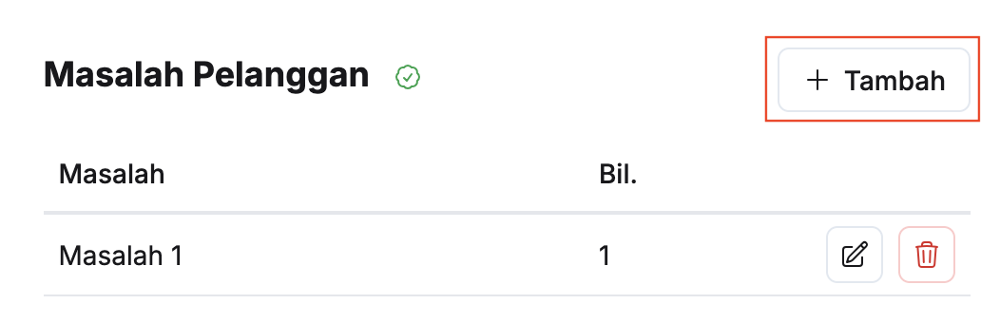
4. Isikan maklumat dalam medan:
    * Keterangan
    * Punca Masalah
     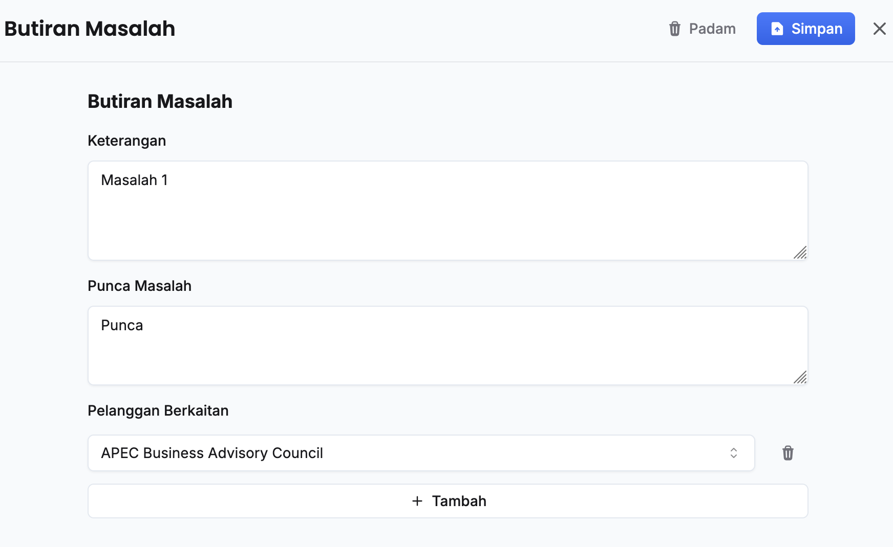
5. Klik butang **+ Tambah**
6. Pilih **Pelanggan berkaitan**
7. Ulang langkah 5-6 sekiranya terdapat lebih daripada satu pelanggan berkaitan
8. Klik butang **Simpan**
9. Pastikan masalah yang berkaitan telah tersenarai

<Outcome>
Masalah pelanggan berjaya ditambahkan
</Outcome>

### Kemaskini Butiran Masalah
Peranan: Penyedia Program / Pengurus Program

Langkah:
1. Klik **Program** pada *Sidebar*
2. Pilih program yang berkaitan
3. Klik butang **Kemaskini** pada sudut kanan masalah yang berkaitan
4. Kemaskini:
    * Keterangan
    * Punca Masalah
    * Pelanggan Berkaitan
5. Klik butang **Simpan**
6. Pastikan butiran masalah yang berkaitan telah dikemaskini

<Outcome>
Butiran masalah pelanggan berjaya dikemaskini
</Outcome>

### Padam Masalah
Peranan: Penyedia Program / Pengurus Program

Langkah:
1. Klik **Program** pada *Sidebar*
2. Pilih program yang berkaitan
 
3. Klik butang **Padam** pada sudut kanan masalah yang berkaitan
 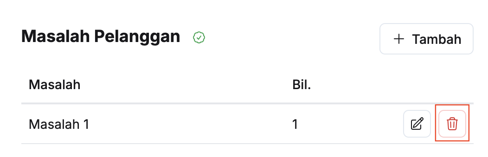
4. Klik butang **Teruskan** pada paparan **Padam Masalah**
5. Pastikan masalah yang berkaitan telah dipadamkan

<Outcome>
Masalah pelanggan berjaya dipadamkan
</Outcome>

## Stakeholder Langsung / Tidak Langsung
### Tambah Stakeholder
Peranan: Penyedia Program / Pengurus Program

Langkah:
1. Klik **Program** pada *Sidebar*
2. Pilih program yang berkaitan
 
3. Klik butang **+ Tambah** pada sudut kanan tajuk **Stakeholder Langsung / Stakeholder Tidak Langsung**
 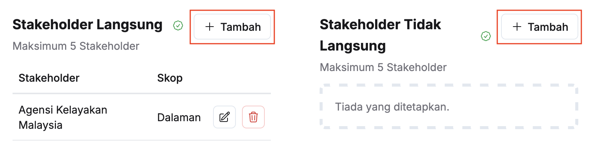
4. Isikan maklumat dalam medan:
    * Kategori Stakeholder
    * Skop Stakeholder
    * Nama Stakeholder
     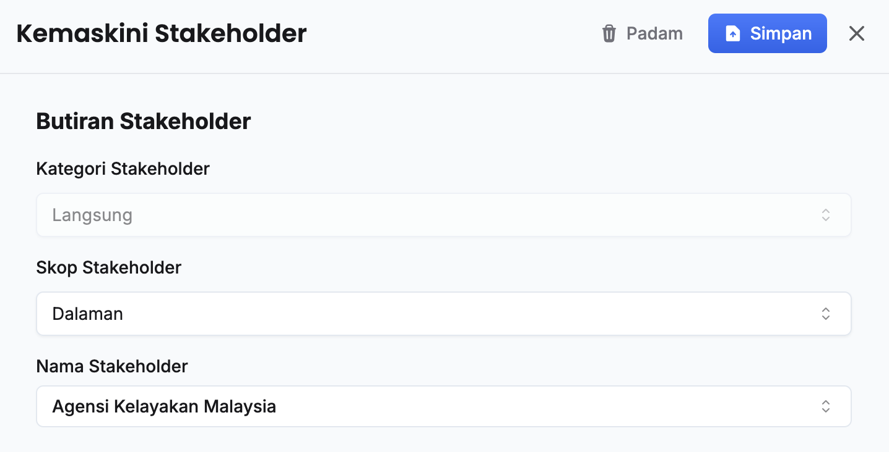
5. Klik butang **Simpan**
6. Pastikan stakeholder telah tersenarai

<Outcome>
Stakeholder berjaya ditambahkan
</Outcome>

### Kemaskini Maklumat Stakeholder 
Peranan: Penyedia Program / Pengurus Program

Langkah:
1. Klik **Program** pada *Sidebar*
2. Pilih program yang berkaitan
 
3. Klik butang **Kemaskini** pada sudut kanan stakeholder yang berkaitan
 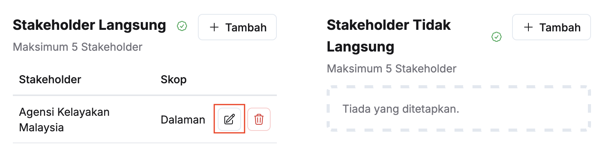
4. Kemaskini:
    * Kategori Stakeholder
    * Skop Stakeholder
    * Nama Stakeholder
     
5. Klik butang **Simpan**
6. Pastikan maklumat stakeholder yang berkaitan telah dikemaskini

<Outcome>
Maklumat stakeholder berjaya dikemaskini
</Outcome>

### Padam Stakeholder 
Peranan: Penyedia Program / Pengurus Program

Langkah:
1. Klik **Program** pada *Sidebar*
2. Pilih program yang berkaitan
 
3. Klik butang **Padam** pada sudut kanan stakeholder yang berkaitan
 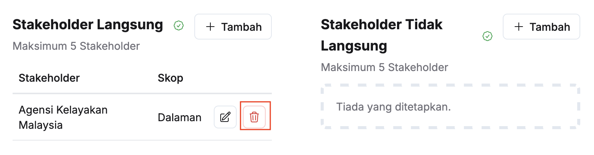
4. Klik butang **Teruskan** pada paparan **Padam Stakeholder**
5. Pastikan stakeholder yang berkaitan telah dipadamkan

<Outcome>
Stakeholder berjaya dipadamkan
</Outcome>

## Keperluan Stakeholder 
### Tambah Keperluan
Peranan: Penyedia Program / Pengurus Program

Langkah:
1. Klik **Program** pada *Sidebar*
2. Pilih program yang berkaitan
 
3. Klik butang **+ Tambah** pada sudut kanan tajuk **Keperluan**
 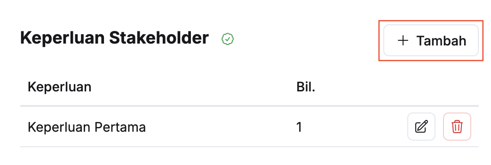
4. Isikan maklumat dalam medan:
    * Keterangan
    * Punca Keperluan
     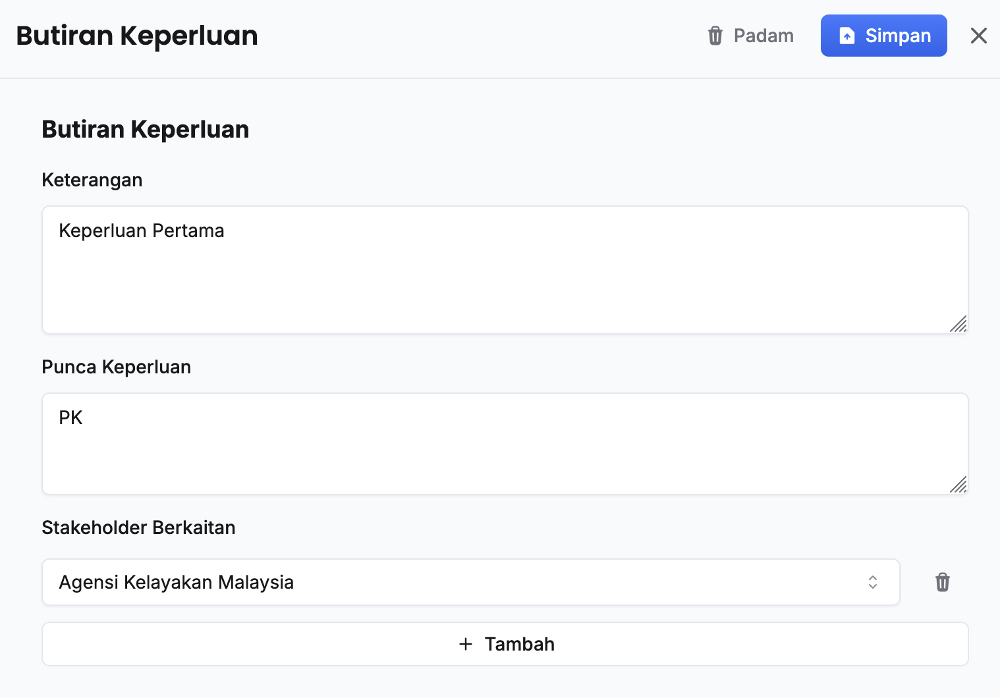
5. Klik butang **+ Tambah**
6. Pilih **Stakeholder berkaitan**
7. Ulang langkah 5-6 sekiranya terdapat lebih daripada satu stakeholder berkaitan
8. Klik butang **Simpan**
9. Pastikan keperluan yang berkaitan telah tersenarai

<Outcome>
Keperluan stakeholder berjaya ditambahkan
</Outcome>

### Kemaskini Butiran Keperluan
Peranan: Penyedia Program / Pengurus Program

Langkah:
1. Klik **Program** pada *Sidebar*
2. Pilih program yang berkaitan
 
3. Klik butang **Kemaskini** pada sudut kanan keperluan yang berkaitan
 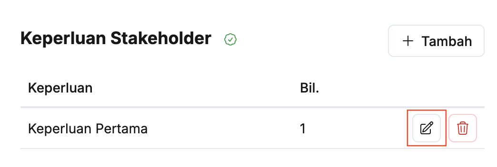
4. Kemaskini:
    * Keterangan
    * Punca Keperluan
    * Stakeholder Berkaitan
     
5. Klik butang **Simpan**
6. Pastikan butiran keperluan yang berkaitan telah dikemaskini

<Outcome>
Butiran keperluan stakeholder berjaya dikemaskini
</Outcome>

### Padam Keperluan
Peranan: Penyedia Program / Pengurus Program

Langkah:
1. Klik **Program** pada *Sidebar*
2. Pilih program yang berkaitan
 
3. Klik butang **Padam** pada sudut kanan keperluan yang berkaitan
 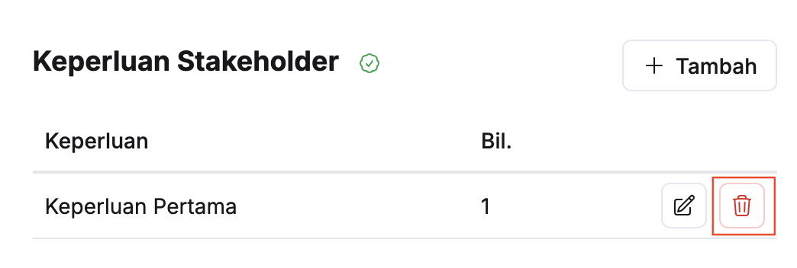
4. Klik butang **Teruskan** pada paparan **Padam Keperluan**
5. Pastikan keperluan yang berkaitan telah dipadamkan

<Outcome>
Keperluan stakeholder berjaya dipadamkan
</Outcome>