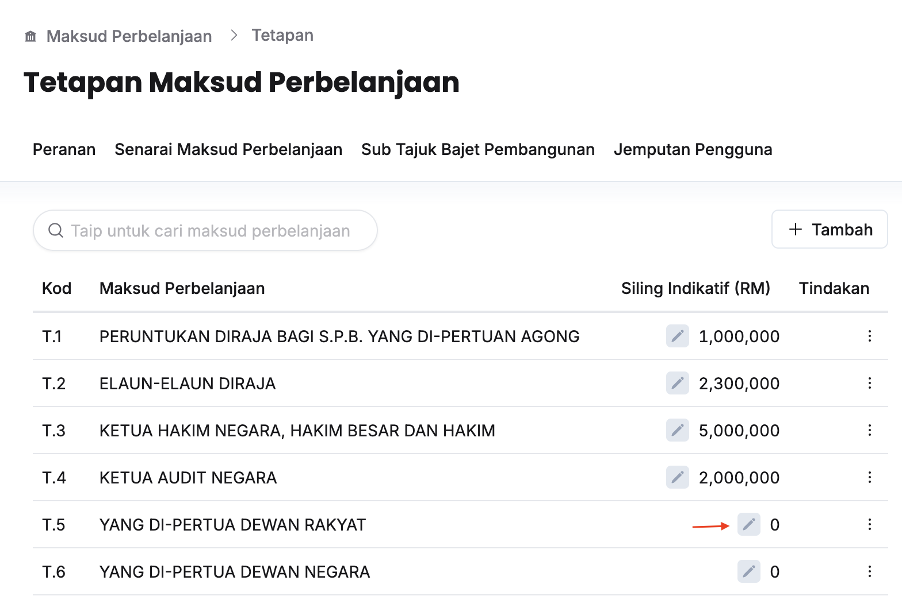
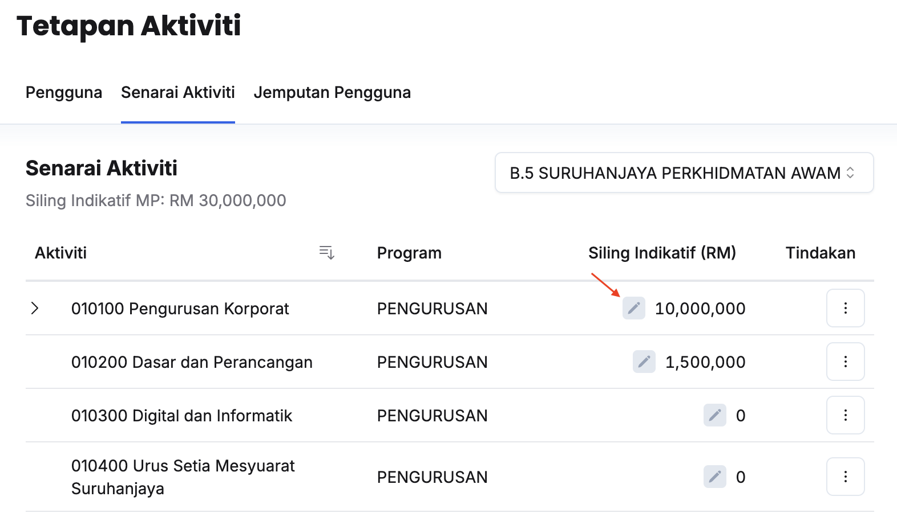

import { Aside } from '@astrojs/starlight/components';
import Outcome from '../../../../components/Outcome.astro';

## Peringkat Kementerian
Peranan: Penyedia Syor Dasar

Langkah:
1. Klik **Maksud Perbelanjaan** pada *Sidebar*
2. Klik butang **Tetapan**
3. Klik tab **Senarai Maksud Perbelanjaan**

4. Klik butang **Kemaskini** dan kunci masuk **Siling Indikatif (RM)** pada Maksud Perbelanjaan yang berkaitan

<Outcome> 
Siling indikatif berjaya diagihkan kepada Kementerian masing-masing
</Outcome>

---

## Peringkat Aktiviti
Peranan: Penyelaras MP  

<Aside title="Pra-syarat" type="caution">
Penyedia Syor Dasar telah melakukan agihan Siling Indikatif pada Maksud Perbelanjaan yang berkaitan
</Aside>

Langkah:
1. Klik **Aktiviti** pada *Sidebar*
2. Klik butang **Tetapan**
3. Klik tab **Senarai Aktiviti**

4. Klik butang **Kemaskini** dan kunci masuk **Siling Indikatif (RM)** pada Aktiviti yang berkaitan

<Outcome> 
Siling indikatif berjaya diagihkan kepada aktiviti Kementerian masing-masing
</Outcome>
